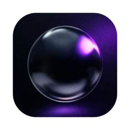

<p align="center">
  
</p>

<h1 align="center">NOX Browser</h1>

<p align="center">
  A lightweight, privacy-focused web browser for macOS, built natively with Swift, SwiftUI and WebKit.<br>
  Built-in ad and tracker blocking, tab sleeping, a download manager, split view, workspaces and a command palette.
</p>

<p align="center">
  <a href="https://github.com/EmreSarikaya35/nox-browser/releases/latest"></a>
  
  
  <a href="LICENSE"></a>
</p>

## Download

Get the latest **[NOX DMG from Releases](https://github.com/EmreSarikaya35/nox-browser/releases/latest)**, open it and
drag NOX to your Applications folder. Requires macOS 14 or later; runs on Intel and Apple Silicon Macs.

NOX is not signed with an Apple Developer ID. On first launch, right-click NOX in Finder and choose **Open**
(or allow it in System Settings → Privacy & Security). Once it lives in `/Applications`, NOX keeps itself up to date.

## Features

- **Ad and tracker blocking** — EasyList and EasyPrivacy out of the box, compiled to WebKit content blockers. Per-site
  toggle, custom filters, blocked-request counter.
- **Easy on the battery** — background tabs go to sleep and release their web process; a battery saver mode and a
  per-tab CPU / memory panel show what is actually using resources.
- **Tabs your way** — favicons, drag to reorder, pinned tabs, vertical tabs, workspaces, split view and multiple windows.
- **Command palette (⌘K)** — run commands, jump to an open tab, search bookmarks and history from one box.
- **Download manager** — pause, resume and cancel; detects downloadable video and audio on the page, including
  unprotected HLS streams.
- **Privacy** — private tabs, clear-on-quit, per-site camera and microphone permissions, passwords stored in the
  macOS Keychain, no telemetry.
- **Dark web pages**, **picture in picture**, bookmark and password **import** from Safari, Chrome and Firefox.
- **English and Turkish** interface, chosen automatically from the system language.
- **A hidden game** — Spirit Quest: The Forgotten Shrine, an offline pixel-art RPG built into the browser.

## Details

### Browsing

- Multiple tabs, close and reopen (⌘T, ⌘W, ⇧⌘T, ⌃Tab)
- Private tabs (⇧⌘N): non-persistent data store, nothing written to history, data dropped when the last private tab closes
- Smart address and search bar with autocomplete from history and bookmarks; choice of search engine
- Back, forward, reload, stop, home; loading progress line
- Bookmarks (⌘D), bookmarks bar (⇧⌘B), sidebar with bookmarks and history (⇧⌘L)
- Start page with clock, date, search, favorites and an optional background image
- Find on page (⌘F), zoom (⌘= / ⌘- / ⌘0), full screen
- Session restore (tabs load only when selected), clear browsing data (Settings, ⌘,)
- Invalid certificates are never accepted silently; an error page is shown instead
- Pop-ups without a user click are blocked; `target=_blank` links open in a new tab

### Ad and tracker blocking

The shield button in the toolbar opens the control panel.

- EasyList and EasyPrivacy are on by default; uBlock filters and AdGuard Turkish are optional. Lists are downloaded on
  first launch, compiled to WebKit content rule lists (`WKContentRuleList`), cached on disk and refreshed in the
  background every four days.
- Network rules (domain, third-party, resource type, `domain=` options), exception (`@@`) rules and CSS cosmetic filters
  are supported. Blocking happens inside WebKit; no JavaScript is injected into pages.
- Per-site allow list, global on/off, custom filters, per-page and total blocked counters.
- Filter lists are not bundled; they are fetched from their own servers (EasyList: GPLv3 / CC BY-SA 3.0).

Known limits — there is **no** guarantee of blocking every ad or of going undetected:

- Rules that WebKit cannot express are skipped: uBlock scriptlets (`##+js`), procedural cosmetic filters (`:has-text`
  etc.), `redirect` / `csp` / `removeparam`, regex rules, cosmetic exceptions (`#@#`) and negated type options such as
  `~script`. As a result, in-video ads on sites that serve ads from the same servers as content (YouTube, for example)
  are not blocked and some anti-adblock walls are not bypassed; turn blocking off for such a site from the panel.
- Because cosmetic exceptions are skipped, a site may occasionally have too much hidden.
- The first page restored at launch may make a few requests before the lists are read from cache.
- The counter relies on a private WebKit delegate call: it is not App Store compatible, and if WebKit removes it the
  counter stays at 0 while blocking keeps working.
- There is no separate third-party cookie switch; WebKit's built-in tracking prevention applies.

### Battery and performance

The gauge button in the toolbar opens the panel.

- **Tab sleeping:** a background tab sleeps after 30 minutes (5 in battery saver mode): its web view and web process
  are released. Returning to the tab reloads the page with its back/forward history. Tabs playing audio or video, or
  using the camera or microphone, are not put to sleep. Tabs can also be put to sleep manually.
- **Battery saver mode:** shortens the sleep delay and turns off interface animations and the glass effect. An option
  turns it on automatically when the Mac is running on battery (off by default).
- **Block autoplay:** videos do not start without a click.
- **Performance panel:** CPU %, memory and wakeups per second for the interface process and each tab, read from the
  kernel (`proc_pid_rusage`) and measured only while the panel is open.

Limits: a sleeping tab loses unsaved form input and scroll position; media inside embedded (iframe) players is not
detected; the tab-to-process mapping uses a private WebKit property; WebKit's shared network and GPU processes are not
shown. No battery-life figures are claimed — measure with the panel or Activity Monitor → Energy.

### Downloads and media

The download button (⌥⌘L) opens the panel and shows the number of active downloads.

- **Files:** content the browser cannot display, or that the server marks as an attachment, is downloaded. Progress,
  size, pause / resume / cancel, simultaneous downloads, Show in Finder, download history.
- **Media on the page:** `<video>` / `<audio>` sources and links to media files are listed with format, resolution and
  size. Unprotected HLS (`.m3u8`) streams are downloaded at the highest quality and joined into one file.
- **Location:** `~/Downloads` by default, changeable from the panel. Existing files are never overwritten.
- **Safety:** path components are stripped from server-suggested file names, files are never opened automatically,
  WebKit applies the quarantine flag, embedded frames cannot trigger downloads, and private-tab downloads are not
  written to history.
- No third-party tools (yt-dlp, ffmpeg, …) are used.

Not supported (listed with the reason, without a download button): streaming or DRM-protected players such as YouTube,
Netflix and Spotify — protections are not circumvented; DASH (`.mpd`) streams; encrypted or live HLS streams. MPEG-TS
HLS streams are saved as `.ts` (playable in VLC or IINA, not QuickTime). Paused downloads are lost when the app quits.

### Privacy, permissions and passwords

- **Site permissions:** when a site asks for the camera or microphone you are prompted (the default button is Deny);
  the decision is remembered per site and can be reset in Settings → Privacy. Private tabs never remember it.
- **Clear on quit:** history, cookies and site data are removed on exit and the session is not restored.
- **Passwords (Keychain):** the key button saves the login typed into a page and fills it on a later visit (the form
  is never submitted for you). Passwords live only in the macOS Keychain, work only on HTTPS pages and only on the exact
  host they were saved for.
- **No telemetry.** The only requests NOX makes on its own are filter list updates, favicons and the update check.

Limits: saving and filling passwords is manual; because the app is ad-hoc signed, macOS asks for your login password
when a new build first reads a saved password; login forms inside embedded frames are not filled.

### Tabs, windows and appearance

- **Favicons** in tabs, the bookmarks bar and the start page
- **Drag to reorder and pin:** pinned tabs move to the front and show only their icon
- **Workspaces:** separate sets of tabs such as "Work" or "School", added in Settings → General; the switcher appears in
  the tab bar once a second workspace exists
- **Vertical tabs**, **split view** (⌃⌘S) and **multiple windows** (⌘N)
- **Command palette** (⌘K)
- **Darken web pages** (⇧⌘K): darkens light sites and leaves sites with their own dark theme alone; off by default
- **Picture in picture** (⌥⌘P)
- **Import:** bookmarks from an exported HTML file, passwords from a CSV file (Safari, Chrome, Firefox)
- **Automatic updates:** checks GitHub Releases once a day; when installed in `/Applications` it downloads and installs
  the new version and offers a Restart button

Limits: only the first window's session is saved; page darkening works by inverting colors, so dark logos can disappear
and some sites look odd; the right pane of split view has no address bar of its own; picture in picture depends on a
private WebKit preference; updates are verified by source repository, bundle identifier and version, not by a
cryptographic signature.

### Language

The interface is available in English and Turkish. If the primary macOS language is Turkish, NOX opens in Turkish;
with any other language it opens in English. Change it in Settings → General → Language (takes effect after a restart).
Source strings in the code are Turkish; English translations live in `NOX/en.lproj/Localizable.strings`.
The built-in Spirit Quest game is Turkish only.

### Built-in game: Spirit Quest

Open it from the start page or with Navigate → Play Spirit Quest (⇧⌘G). The game ships inside the app bundle
(`SpiritQuest/`), needs no network and is served from the internal `nox://game/` address. Saves live in the browser's
site data, so clearing browsing data removes them. See [SpiritQuest/README.md](SpiritQuest/README.md).

### Not included

- **Web notifications and location:** WKWebView offers no public API for them, so sites cannot request either
- **Extensions:** Chrome extensions do not run on WebKit, and Apple's `WKWebExtension` support needs a newer macOS
  than the macOS 14 target
- Reader mode and a privacy report

## Build from source

Requires Xcode 15 or later and [XcodeGen](https://github.com/yonaskolb/XcodeGen) (`brew install xcodegen`).
The Xcode project is generated from `project.yml`.

```bash
xcodegen generate
open NOX.xcodeproj        # run with ⌘R in Xcode
```

From the command line:

```bash
xcodebuild -project NOX.xcodeproj -scheme NOX -configuration Debug -derivedDataPath build build
open build/Build/Products/Debug/NOX.app
```

Build a universal (Intel + Apple Silicon) DMG:

```bash
Scripts/make-dmg.sh       # build/NOX.dmg
```

The app icon is generated from `Scripts/logo.jpg`; replace it and run `Scripts/make-icon.sh`.

## Tests and debugging

```bash
xcodebuild -project NOX.xcodeproj -scheme NOX -derivedDataPath build test
```

- Unit tests live in `NOXTests/`: address resolution, filter conversion, process sampling, download names, media
  parsing, Keychain, import, HLS parsing and download, version comparison, language selection.
- Filter list download and compile errors appear in the panel and in Console with the `NOX AdBlock` prefix.
- Data is stored in `~/Library/Application Support/NOX/`; settings via `defaults read com.nox.browser`.
- To test tab sleeping quickly: `defaults write com.nox.browser sleepDelay -int 10`.
- To test certificate errors: `https://expired.badssl.com`.

## Signing and notarization

The project is ad-hoc signed (`CODE_SIGN_IDENTITY = "-"`), so Gatekeeper warns when the DMG is opened on another Mac.
For warning-free distribution:

1. Join the Apple Developer Program and create a "Developer ID Application" certificate
2. Set `DEVELOPMENT_TEAM` and `CODE_SIGN_IDENTITY: "Developer ID Application"` in `project.yml`
   (Hardened Runtime is already on for Release)
3. `xcrun notarytool submit build/NOX.dmg --keychain-profile <profile> --wait`
4. `xcrun stapler staple build/NOX.dmg`

## Architecture

| File | Responsibility |
|---|---|
| `NOX/Tab.swift` | A single tab: WKWebView lifecycle, navigation and UI delegates, find, zoom, sleeping |
| `NOX/TabManager.swift` | One window's tabs: workspaces, pinning, split view, session saving |
| `NOX/AdBlockConverter.swift` | Adblock Plus syntax → WebKit content blocker rules |
| `NOX/AdBlockEngine.swift` | Downloading, compiling and updating filter lists; allow list; counter |
| `NOX/AdBlockPanel.swift` | Ad blocker control panel |
| `NOX/DownloadManager.swift` | WKDownload-based downloads, pause/resume, history, safe file names |
| `NOX/MediaDetector.swift` | Finds downloadable media sources on a page |
| `NOX/HLS.swift` | HLS playlist parsing and download |
| `NOX/DownloadsPanel.swift` | Downloads and page media panel |
| `NOX/Services.swift` | Services shared between windows, favicon cache, power monitoring, updater |
| `NOX/CommandPalette.swift` | Command palette |
| `NOX/Importer.swift` | Bookmark (HTML) and password (CSV) import |
| `NOX/GameSchemeHandler.swift` | Serves the built-in game from `nox://game/` |
| `NOX/PrivacyManager.swift` | Per-site camera and microphone permissions, clear on quit |
| `NOX/PasswordManager.swift` | Password storage in the Keychain |
| `NOX/PasswordPanel.swift` | Save and fill password panel |
| `NOX/Settings.swift` | Settings window (General, Privacy, Passwords) |
| `NOX/PerformanceMonitor.swift` | Per-process CPU, memory and wakeup sampling |
| `NOX/PerformancePanel.swift` | Battery saver settings and performance panel |
| `NOX/SiteStore.swift` | JSON store for history and bookmarks |
| `NOX/URLResolver.swift` | Input → URL or search; search engines |
| `NOX/BrowserView.swift` | Tab bar, toolbar, page area, find bar, suggestions |
| `NOX/Panels.swift` | Start page, bookmarks bar, sidebar |
| `NOX/NOXApp.swift` | App entry point, menus and keyboard shortcuts |
| `NOX/Theme.swift` | Color palette, icon button, language selection |

## License

[MIT](LICENSE)

## Credits

- **Design:** Burak Sarıkaya
- **Development:** Emre Sarıkaya

---

<p align="center">
  <a href="README.tr.md"></a>
</p>
